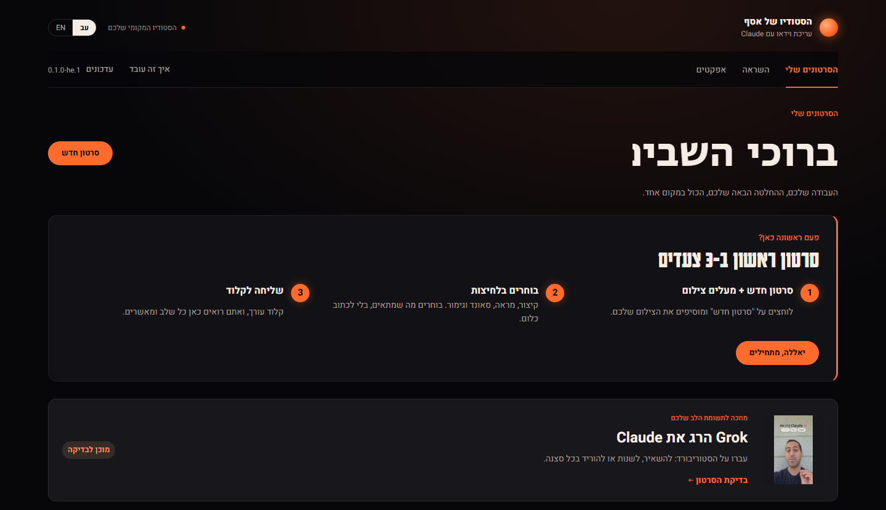
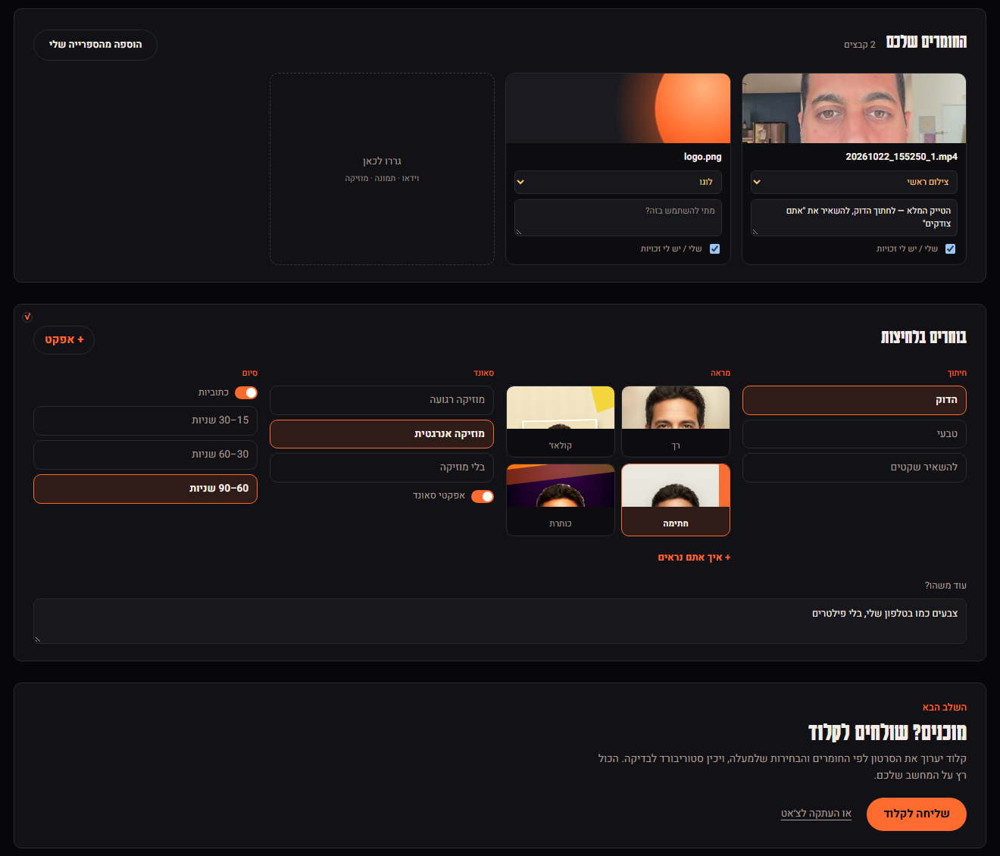
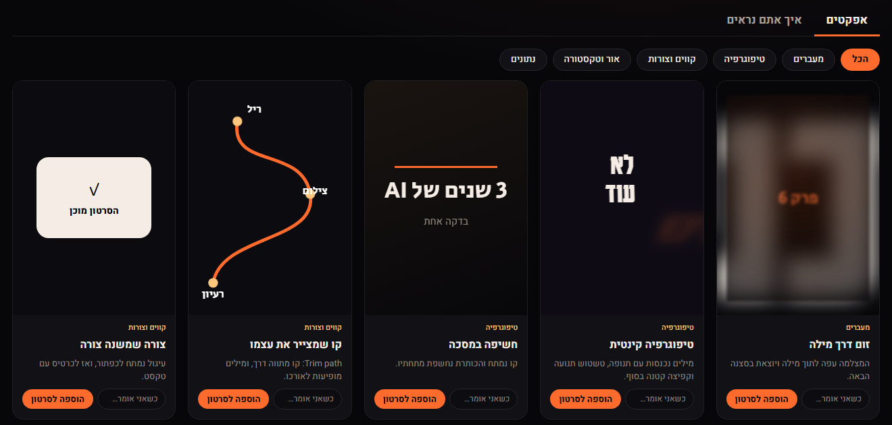
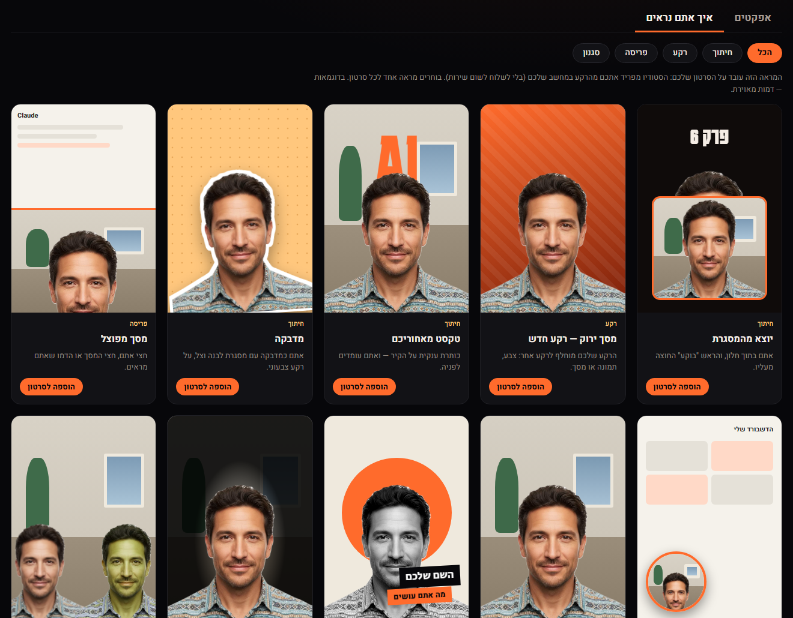
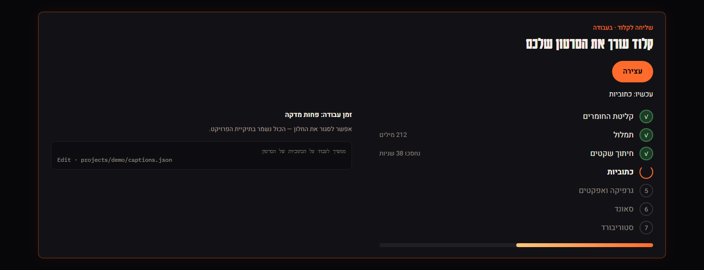
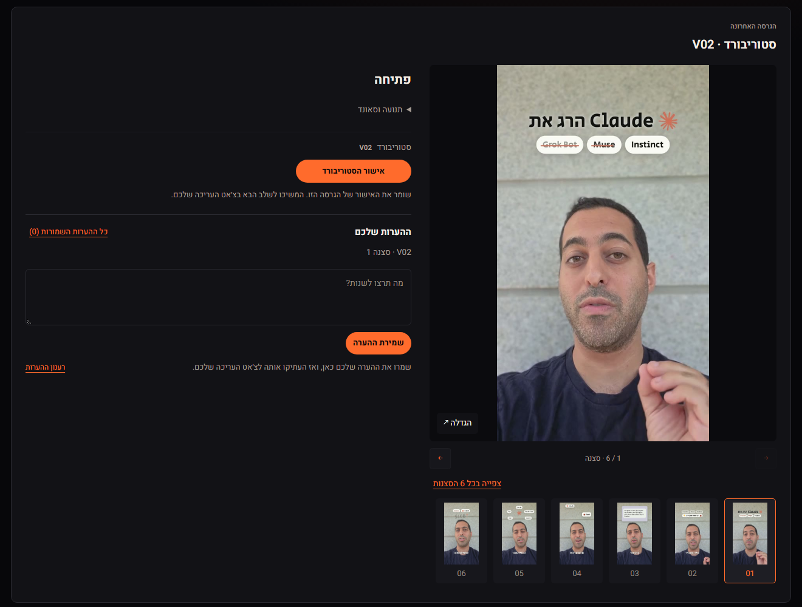
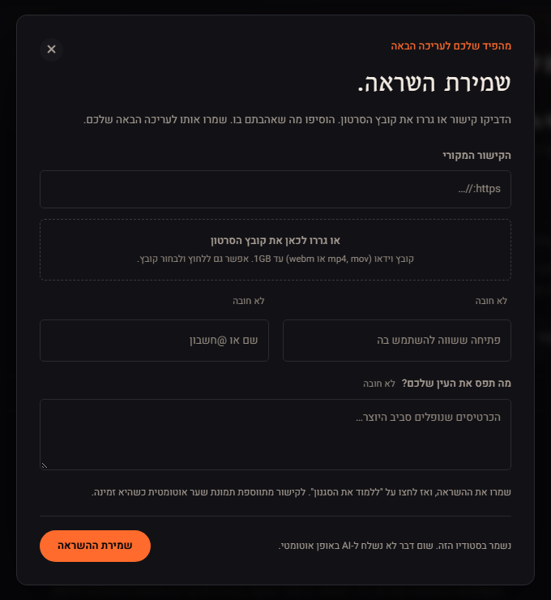

# The video editing studio

> **Claude Code:** if someone sent you here to install this studio, follow the section "If you are Claude Code" at the end of this file.

**A Hebrew-first video editing studio that runs on your own computer.**
Upload your take, choose how the video should look in a few taps, and Claude edits: cuts, captions, graphics and sound.
You see every step and approve it. Free, and your files stay with you.

[עברית](README.md)



## Install with one message

Open Claude Code, paste this message and send it:

```text
Use the video studio skill from https://github.com/asaf5767/claude-video-studio — install everything it needs, ask me before each install, and explain in plain English what you're doing. When it's ready, open the studio in my browser.
```

From there Claude leads: it asks which folder to put the studio in, checks what your computer
is missing, and asks you before each install. At the end the studio opens in your browser.

A few things worth knowing up front:
- Claude Code asks for your OK before each thing it does on your computer. That is normal: read its explanation and approve.
- On Windows a window may pop up: "Do you want to allow this app to make changes?". Click "Yes".
- On a Mac you may be asked for your computer's password (the one you log in with). You will not see it as you type, and that is normal.

## How it works

### 1. Upload your take and choose with taps

Drop in your video, images and logo. Then choose: how tight to cut, which look, which sound and how long. No prompts to write.



### 2. Add effects, and choose how you look

An After Effects style board: every card shows its effect in motion. You can ask for it to appear exactly when you say a certain word.



And in the "How you look" tab: a new background behind you, text that passes behind you, a sticker cut-out, split screen and more. The studio separates you from the background on your own computer, without sending anything to a service.



### 3. Send to Claude

One click and Claude starts working. The studio shows what it is doing right now: Hebrew transcription, silence cuts, captions, graphics, sound and storyboard. You can close the window; everything is saved.



### 4. Review and approve

For each storyboard scene: keep, change or remove, with a note in your own words. Claude fixes it from your notes, and at the end you get an MP4 ready for Instagram.



### Also: inspiration from reels you like

Paste a link or drop a reel you like, and the studio learns its style (pace, captions, transitions) and uses it in your next video.



## What is in the studio

- **Hebrew interface** (switch to English with one tap), right-to-left captions.
- **Hebrew transcription on your computer**, free.
- **4 ready-made looks, 18 effects and 10 "how you look" looks**.
- **Faceless reels:** just your voice works too.
- **iPhone videos** work.
- **Optional add-ons:** AI voice and images, with your own key.

## What you need

- **Claude Code**, installed and signed in to your account.
- A **Windows** PC or a **Mac**.
- **Internet** for the first setup. After that, the editing itself runs on your computer.
- About **3.5GB free** disk space. Most of it goes to the model that understands Hebrew speech (1.6GB).
  The rest: the editing tools (about 1GB), plus extras you can skip: background removal (about 380MB) and English speech (about 150MB).
- The first setup takes roughly 15 to 45 minutes, depending on your internet speed.

## Open the studio again

Open Claude Code in the studio folder (for example `claude-video-studio` in your home folder, the one named after your user name).
If it asks whether you trust the folder, say yes. Then write:

```text
Open the studio for me
```

If you are used to a terminal (your computer's command window), you can also run this from the studio folder:
`python style-library/start.py --open` on Windows (if `python` does not work, use `py -3` instead),
or `python3 style-library/start.py --open` on a Mac.

If something gets stuck, write `/setup-studio` to Claude Code in the studio folder. It checks what is missing and finishes only that.
The manual steps are in [SETUP.md](SETUP.md).

## Credit and licence

Based on [AI Video Studio](https://github.com/mattp68/ai-video-studio) by Matt Paige, open source under the MIT licence.
This version adds a Hebrew interface (with an English switch), a new design, local Hebrew transcription and tap-to-choose editing.

[MIT](LICENSE) licence. Third-party assets and libraries keep their own licences: [THIRD_PARTY_NOTICES.md](THIRD_PARTY_NOTICES.md).

---

## If you are Claude Code

The person who sent you here wants this video studio installed and opened on their computer.
They are not technical. Do this:

1. **Ask which folder** to put the studio in. Suggest `~/claude-video-studio`
   (on Windows: `%USERPROFILE%\claude-video-studio`). If that folder already holds the studio
   (it has `style-library/start.py`), use it as it is and skip step 2.
2. **Get the files:** `git clone https://github.com/asaf5767/claude-video-studio <folder>`.
   If `git` is missing, explain in one sentence what it is ("the tool that downloads the studio
   and later its updates") and offer two choices: install it (Windows:
   `winget install --id Git.Git -e --source winget --accept-source-agreements --accept-package-agreements`,
   and say "installing accepts its free licence terms"; Mac: `xcode-select --install`, which opens an Apple window
   where they click Install), or download the ZIP instead, no install needed:
   https://github.com/asaf5767/claude-video-studio/archive/refs/heads/main.zip
   (unpack it and rename the `claude-video-studio-main` folder inside to the chosen folder).
3. **Follow `.claude/skills/setup-studio/SKILL.md` from the cloned folder.** Read that file and
   do what it says, running every command inside the studio folder: if this session was not
   opened there, start each command with `cd "<folder>" && `. It checks what is missing, asks
   before each install and ends by opening the studio.
4. **Throughout:** talk to them in plain words in their language (English if they wrote to you
   in English), one short step at a time. Ask before every install or download and wait for a
   yes. Never paste error output or tracebacks: say in one sentence what failed and offer to
   copy the details. Never publish, push or upload the user's work. At the end, open the studio
   in their browser and tell them how to open it again next time.