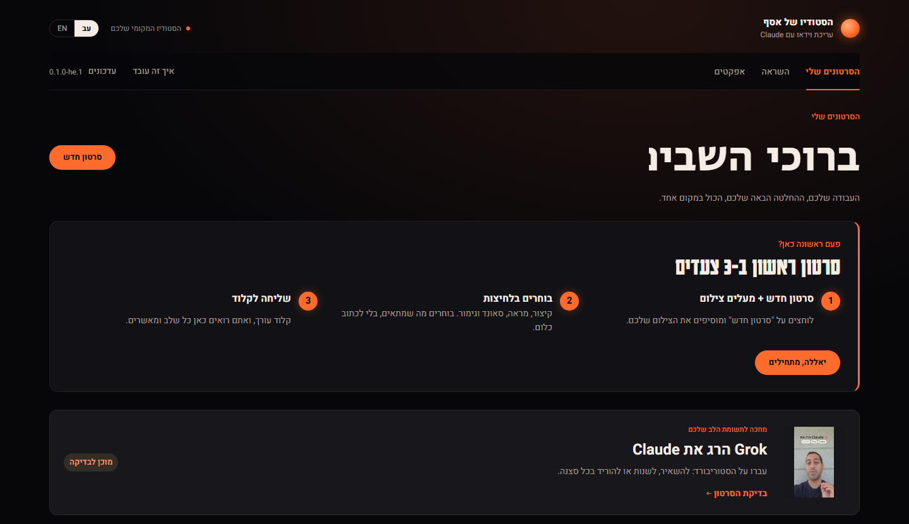
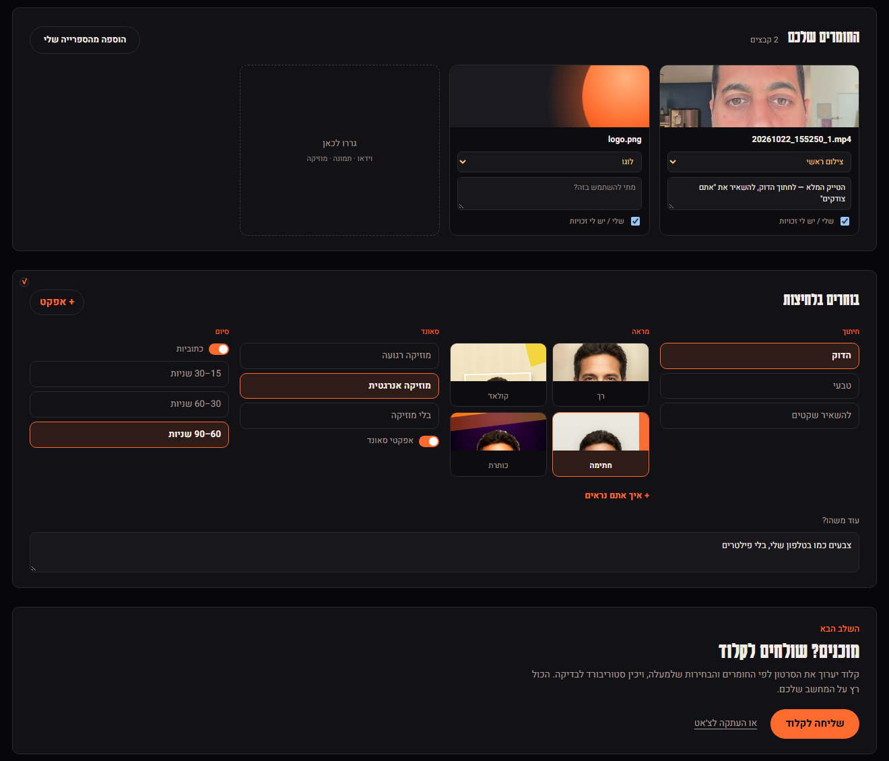
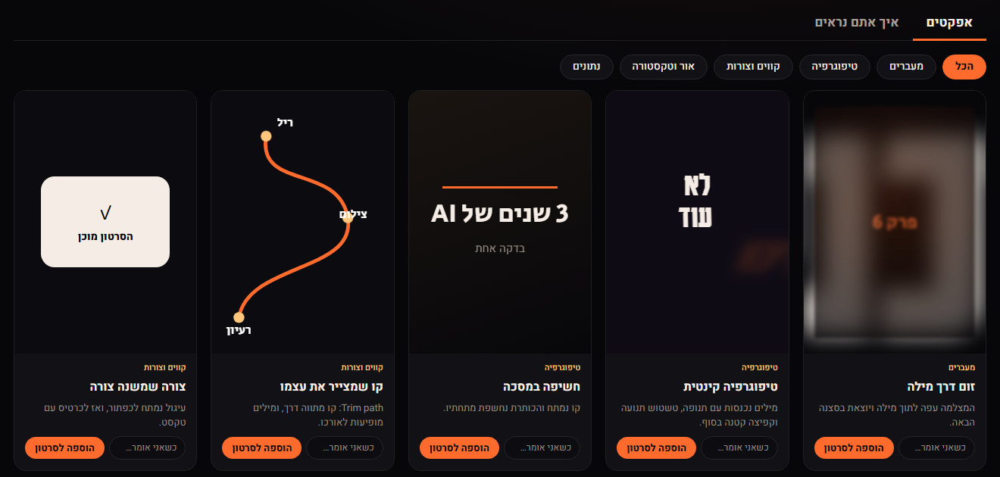
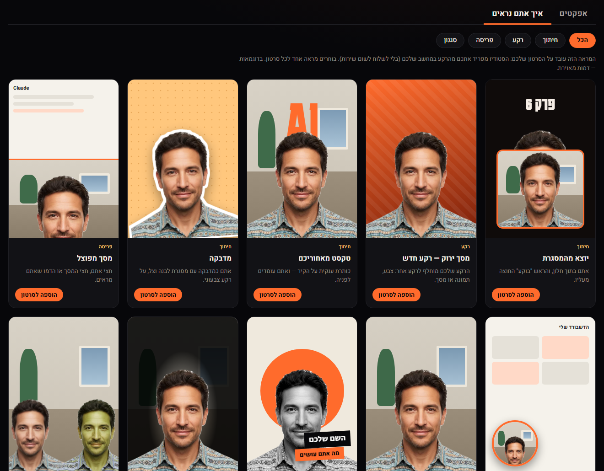
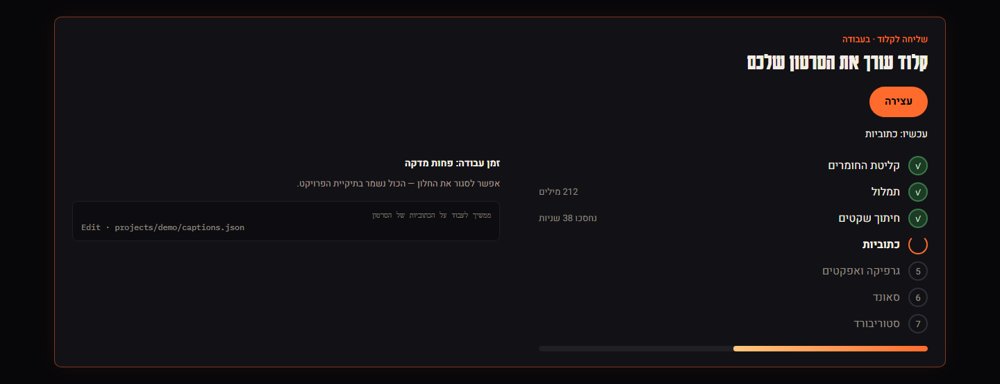
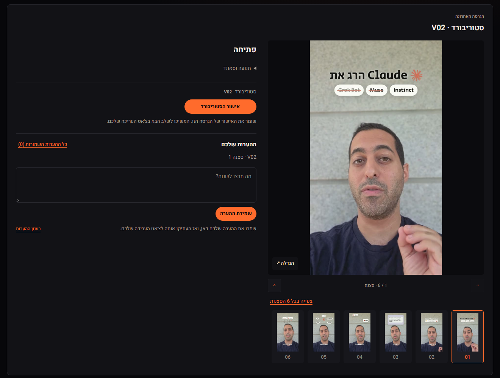
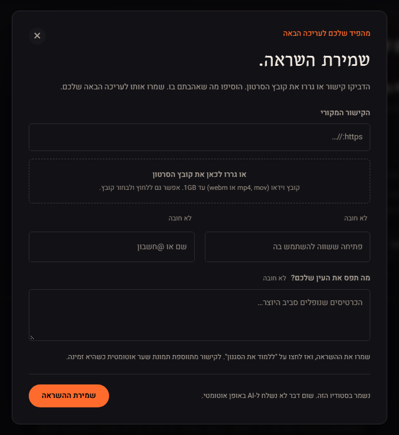

# הסטודיו לעריכת וידאו

> **Claude Code:** if someone sent you here to install this studio, follow the section "If you are Claude Code" at the end of this file.

**סטודיו לעריכת סרטונים בעברית, שרץ אצלכם על המחשב.**
מעלים צילום, בוחרים בכמה לחיצות איך הסרטון ייראה, ו-Claude עורך: חיתוכים, כתוביות, גרפיקה וסאונד.
אתם רואים כל שלב ומאשרים. חינם, והקבצים שלכם נשארים אצלכם.

[English](README.en.md)



## התקנה בהודעה אחת

פתחו את Claude Code, הדביקו את ההודעה הזאת ושלחו:

```text
תשתמש בסקיל של הסטודיו לעריכת וידאו מהכתובת הזאת: https://github.com/asaf5767/claude-video-studio — תתקין את כל מה שצריך, תשאל אותי לפני כל התקנה, ותסביר לי בעברית פשוטה מה אתה עושה. כשהכל מוכן, תפתח לי את הסטודיו בדפדפן.
```

מכאן Claude מוביל: הוא שואל באיזו תיקייה לשים את הסטודיו, בודק מה חסר במחשב,
ושואל אתכם לפני כל התקנה. בסוף הסטודיו נפתח בדפדפן.

כמה דברים שכדאי לדעת מראש:
- Claude Code מבקש אישור לפני כל פעולה שהוא עושה במחשב. זה תקין: קראו את ההסבר שלו ואשרו.
- ב-Windows יכול לקפוץ חלון "לאפשר לאפליקציה לבצע שינויים?". לחצו "כן".
- ב-Mac ייתכן שתתבקשו להקליד את הסיסמה של המחשב (זו שאתם נכנסים איתה). לא רואים אותה כשמקלידים, וזה תקין.

## איך זה עובד

### 1. מעלים צילום ובוחרים בלחיצות

גוררים את הצילום, תמונות ולוגו. ואז בוחרים: כמה הדוק לחתוך, איזה מראה, איזה סאונד וכמה ארוך. בלי לכתוב פרומפטים.



### 2. מוסיפים אפקטים, ובוחרים איך אתם נראים

לוח אפקטים בסגנון After Effects: כל כרטיס מראה את האפקט בפעולה. אפשר לבקש שיופיע בדיוק כשאתם אומרים מילה מסוימת.



ובלשונית "איך אתם נראים": רקע חדש מאחוריכם, טקסט שעובר מאחוריכם, מדבקה, מסך מפוצל ועוד. הסטודיו מפריד אתכם מהרקע על המחשב שלכם, בלי לשלוח לשום שירות.



### 3. שליחה לקלוד

לחיצה אחת, ו-Claude מתחיל לעבוד. רואים בסטודיו מה הוא עושה עכשיו: תמלול בעברית, חיתוך שקטים, כתוביות, גרפיקה, סאונד וסטוריבורד. אפשר לסגור את החלון, הכול נשמר.



### 4. בודקים ומאשרים

לכל סצנה בסטוריבורד: להשאיר, לשנות או להוריד, עם הערה במילים שלכם. Claude מתקן לפי ההערות, ובסוף מקבלים סרטון MP4 מוכן לאינסטגרם.



### ועוד: השראה מרילס שאהבתם

מדביקים קישור או גוררים רילס שאהבתם, והסטודיו לומד ממנו את הסגנון (קצב, כתוביות, מעברים) ומשתמש בו בסרטון הבא שלכם.



## מה יש בסטודיו

- **ממשק בעברית** (עם מעבר לאנגלית בלחיצה), כתוביות מימין לשמאל.
- **תמלול בעברית על המחשב שלכם**, בחינם.
- **4 מראות מוכנים, 18 אפקטים ו-10 מראות של "איך אתם נראים"**.
- **רילס בלי פנים:** אפשר גם עם הקול שלכם בלבד.
- **גם סרטונים מהאייפון** עובדים.
- **תוספות לא חובה:** קול ותמונות בבינה מלאכותית, עם מפתח משלכם.

## מה צריך

- **Claude Code**, מותקן ומחובר לחשבון שלכם.
- מחשב **Windows** או **Mac**.
- **אינטרנט** בהתקנה הראשונה. אחר כך העריכה עצמה רצה על המחשב שלכם.
- כ-**3.5GB פנויים** בדיסק. רוב המקום הולך למודל שמבין דיבור בעברית (1.6GB).
  השאר: כלי העריכה (כ-1GB), ותוספות שאפשר לוותר עליהן: הסרת רקע (כ-380MB) ודיבור באנגלית (כ-150MB).
- בפעם הראשונה ההתקנה לוקחת בערך 15 עד 45 דקות, לפי מהירות האינטרנט.

## לפתוח את הסטודיו שוב

פתחו את Claude Code בתיקיית הסטודיו (למשל `claude-video-studio` בתיקיית הבית שלכם, התיקייה עם שם המשתמש שלכם).
אם הוא שואל אם אתם סומכים על התיקייה, ענו שכן. ואז כתבו:

```text
תפתח לי את הסטודיו
```

למי שרגיל לטרמינל (חלון הפקודות של המחשב), אפשר גם ישירות מתוך תיקיית הסטודיו:
`python style-library/start.py --open` ב-Windows (אם `python` לא עובד, במקומו `py -3`),
או `python3 style-library/start.py --open` ב-Mac.

אם משהו נתקע, כתבו ל-Claude Code בתיקיית הסטודיו `/setup-studio`. הוא בודק מה חסר ומשלים רק את זה.
ההוראות הידניות נמצאות ב-[SETUP.md](SETUP.md).

## קרדיט ורישיון

מבוסס על [AI Video Studio](https://github.com/mattp68/ai-video-studio) של Matt Paige, בקוד פתוח ברישיון MIT.
הגרסה הזאת: ממשק בעברית (עם מעבר לאנגלית), עיצוב חדש, תמלול מקומי בעברית ובחירות בלחיצות.

רישיון [MIT](LICENSE). לנכסים ולספריות של צד שלישי יש רישיונות משלהם: [THIRD_PARTY_NOTICES.md](THIRD_PARTY_NOTICES.md).

---

## If you are Claude Code

The person who sent you here wants this video studio installed and opened on their computer.
They are not technical and they speak Hebrew. Do this:

1. **Ask which folder** to put the studio in. Suggest `~/claude-video-studio`
   (on Windows: `%USERPROFILE%\claude-video-studio`). If that folder already holds the studio
   (it has `style-library/start.py`), use it as it is and skip step 2.
2. **Get the files:** `git clone https://github.com/asaf5767/claude-video-studio <folder>`.
   If `git` is missing, explain in one sentence what it is ("the tool that downloads the studio
   and later its updates") and offer two choices: install it (Windows:
   `winget install --id Git.Git -e --source winget --accept-source-agreements --accept-package-agreements`,
   and say "ההתקנה מאשרת את תנאי השימוש החינמיים שלו."; Mac: `xcode-select --install`, which opens an Apple window
   where they click Install), or download the ZIP instead, no install needed:
   https://github.com/asaf5767/claude-video-studio/archive/refs/heads/main.zip
   (unpack it and rename the `claude-video-studio-main` folder inside to the chosen folder).
3. **Follow `.claude/skills/setup-studio/SKILL.md` from the cloned folder.** Read that file and
   do what it says, running every command inside the studio folder: if this session was not
   opened there, start each command with `cd "<folder>" && `. It checks what is missing, asks
   before each install and ends by opening the studio.
4. **Throughout:** talk to them in plain Hebrew (their language), one short step at a time.
   Ask before every install or download and wait for a yes. Never paste error output or
   tracebacks: say in one sentence what failed and offer to copy the details. Never publish,
   push or upload the user's work. At the end,
   open the studio in their browser and tell them how to open it again next time.